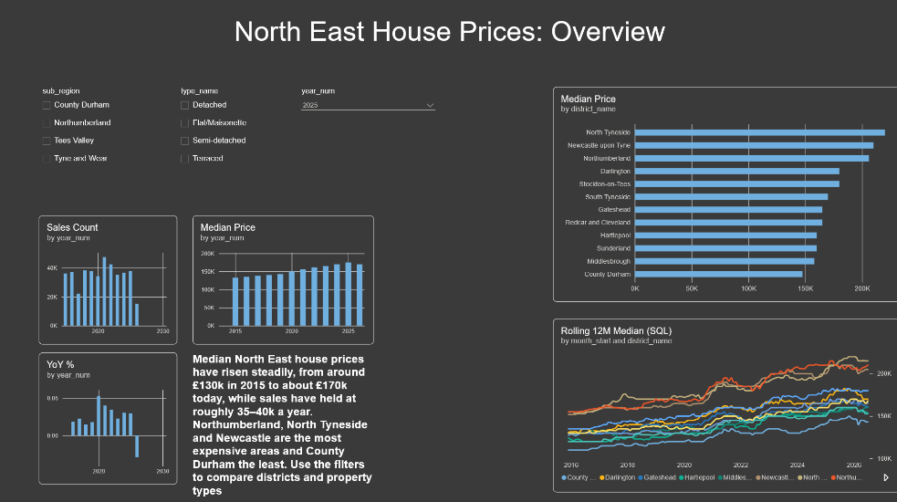
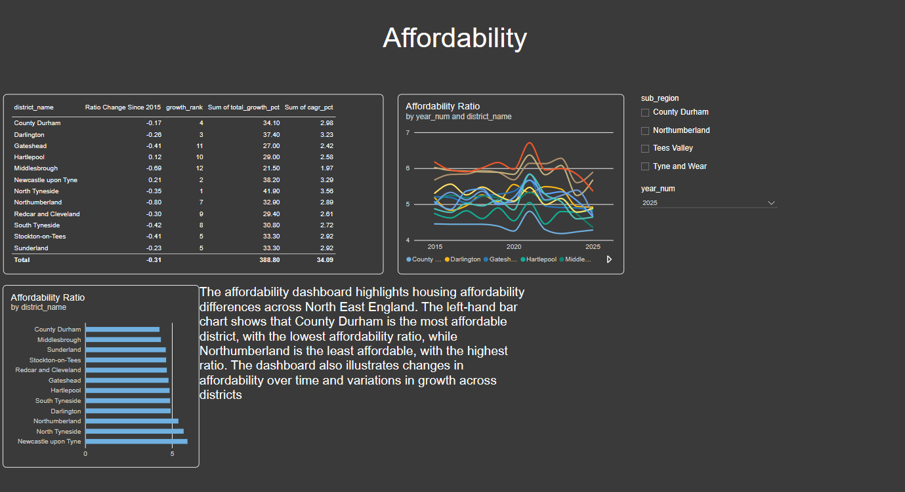
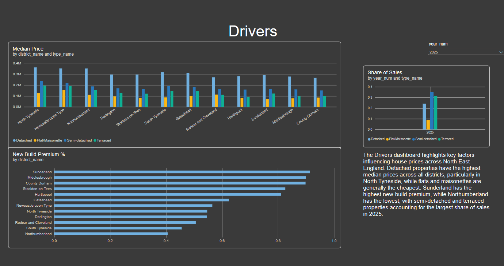
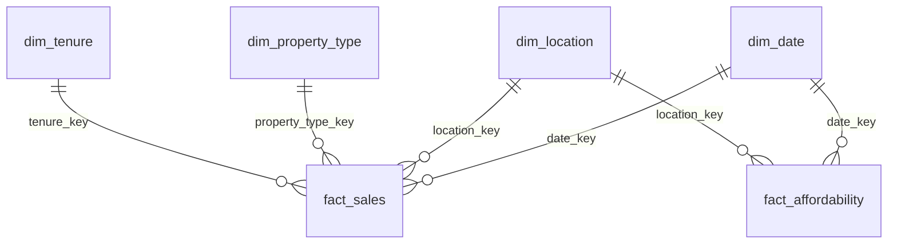

# North East England House Prices: Affordability and Price Drivers

An end-to-end analytics project. Raw HM Land Registry and ONS data is loaded, cleaned and audited in **SQL Server**, modelled as a **star schema**, and presented in a three-page **Power BI** report on how affordable homes are across the North East's 12 local authorities, and how that has changed since 2015.

| | |
|---|---|
| **Question** | Where in the North East is housing most affordable, what drives price differences, and how has that changed since 2015? |
| **Audience** | An investor comparing price growth and entry prices across districts. |
| **Stack** | SQL Server (T-SQL), SSMS, Power BI Desktop (DAX), Git |
| **Scope** | 12 local authorities, sales from 2015 to June 2026 |



## Key findings

1. **[Newcastle upon Tyne]** is the most affordable area at **[5.89]** times local earnings in [2025], against **[4.28]** in **[County Durham]**.
2. The regional median price rose from about **[132.5]k** in 2015 to **£[175]k** in 2025, an increase of **[132]%**. **[Tyne and Wear]** grew fastest (**[134]%**) and **[Tees Valley]** slowest (**[132]%**).
3. New builds sold at a median **[0.91]%** premium over existing homes in **[Sunderland]**.
4. **[Northumberland)** has the highest decrease in affordability at **[-0.8]** between 2015 and 2025.

## Report pages

| Overview | Affordability | Drivers |
|---|---|---|
|  |  |  |

A PDF export is in [`powerbi/`](PowerBI/). The `.pbix` file is included and opens in Power BI Desktop (Windows).

## Data sources

| Source | Provides | Grain |
|---|---|---|
| HM Land Registry, Price Paid Data | Every residential property sale in England and Wales | One row per sale |
| ONS, House price to residence-based earnings ratio | Median house price to earnings ratio | Local authority, annual |

Contains HM Land Registry data (c) Crown copyright and database right [2026]. This data is licensed under the Open Government Licence v3.0.
Contains public sector information licensed under the Open Government Licence v3.0 (ONS).

**Raw data is not included in this repository.** See [How to reproduce](#how-to-reproduce).

## How it works

```
staging (raw, text)  ->  clean (typed, validated, audited)  ->  dw (star schema)  ->  Power BI
```



- **Raw layer:** files are loaded exactly as received, all columns as text, so the source is never altered.
- **Clean layer:** types are converted, postcodes standardised, property types and tenure decoded. Nothing is deleted. Every rejected row is **labelled with a reason**, which gives an audit trail.
- **Warehouse layer:** `fact_sales` (one row per sale) and `fact_affordability` (one row per district per year), with date, location, property type and tenure dimensions.
- **Aggregates:** monthly and rolling 12-month medians are pre-computed in SQL for fast reporting.

Full column definitions are in [`DATA_DICTIONARY.md`](DATA_DICTIONARY.md).

### Cleaning decisions

| Rule | Why | Rows affected |
|---|---|---|
| Category B sales excluded | Repossessions and bulk transfers are not ordinary market sales | [101,797] |
| Price below GBP 10,000 or above GBP 5,000,000 excluded | Token transfers and outliers | [17] |
| Duplicate registrations removed | Same address, date and price under different IDs | [1133] |
| **Rows kept** | | [**[80.32]%**] |

*(Counts come from the audit summary at the end of `sql/04_clean_price_paid.sql`.)*

### Design choices worth knowing

- **Medians, not averages.** Property prices are right-skewed, so a few expensive sales pull averages up. SQL uses `PERCENTILE_CONT(0.5)` and DAX uses `MEDIAN`.
- **Rolling median needs a month spine.** `PERCENTILE_CONT` does not accept a window frame, so the rolling 12-month median joins each month to the previous 12 months of sales.
- **Affordability is annual and sits at its own grain.** It joins to the date dimension on 1 January of each year and is never joined to individual sales.
- **Filtering on district, not county.** County spellings vary in the Land Registry data, and district maps cleanly to ONS codes.

## Skills demonstrated

- **SQL:** layered ETL, `BULK INSERT`, `TRY_CAST`, CTEs, window functions (`LAG`, `RANK`, `FIRST_VALUE`, `NTILE`), `PERCENTILE_CONT`, dynamic SQL, views, indexes, constraints
- **Data modelling:** star schema, surrogate keys, a date dimension, facts at different grains
- **Power BI:** relationships, DAX (`CALCULATE`, `SAMEPERIODLASTYEAR`, `DIVIDE`, `ALLSELECTED`), slicers and interaction control, dashboard design for a stated audience

## Limitations

- Price Paid covers registered sales only. It excludes rentals and unsold homes, and the mix of homes that sell changes each year.
- ONS affordability data is annual and at local authority level only.
- Small districts have few new-build sales a year, so the new-build premium is volatile.
- **EPC (energy certificate) data was not loaded in this version.** The national dataset is about 90 GB. The scripts include the matching logic (`sql/optional/`), but price per square metre and energy rating analysis are future work.
- Data quality checks are implemented as SQL checks and database constraints, not as dbt tests.
- The latest year is partial, so year-on-year change for that year is not comparable.

## How to reproduce

1. Install SQL Server (Developer edition) and SSMS.
2. Download the Price Paid yearly files from gov.uk, and the ONS workbook. Save the **median, local authority** sheet as CSV with a single heading row.
3. Put the files in a folder SQL Server can read (for example `C:\Housingdata`) and edit the paths at the top of `01_stage_price_paid.sql` and `03_stage_ons_ratio.sql`.
4. Open each script from the `sql/` folder in its own SSMS tab and run them in this order:

| Order | Script | Purpose |
|---|---|---|
| 1 | `00_setup.sql` | Database, schemas, helper functions, district lookup |
| 2 | `01_stage_price_paid.sql` | Load Price Paid files |
| 3 | `02b_epc_placeholder.sql` | Empty EPC table (EPC not loaded) |
| 4 | `03_stage_ons_ratio.sql` | Load ONS ratio CSV |
| 5 | `04_clean_price_paid.sql` | Clean and audit sales |
| 6 | `05_clean_epc_and_ratio.sql` | Clean EPC and ratio |
| 7 | `06_dimensions.sql` | Dimension tables |
| 8 | `07_epc_match.sql` | EPC match (finds nothing without EPC data) |
| 9 | `08_fact_tables.sql` | Fact tables |
| 10 | `05b_fix_ratio.sql` | Rebuild ratio tables and fill `fact_affordability` |
| 11 | `09_aggregates_and_views.sql` | Medians, YoY, growth ranking |
| 12 | `10_analysis_queries.sql` | Analysis queries |
| 13 | `11_data_quality_checks.sql` | Reconciliation and checks |

5. Open `powerbi/*.pbix`, point it at your `ne_housing` database, and refresh.

## Licence

Code is released under the MIT licence (see `LICENSE`). Data remains under the original Open Government Licence terms of its publishers.
